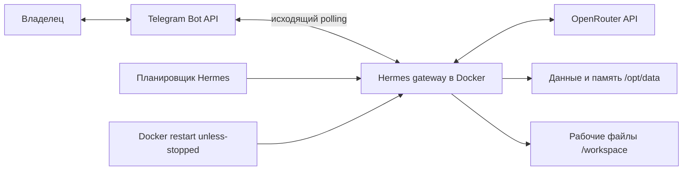

# Hermes Agent Lab — P1

Практическая работа: развернуть автономного агента на отдельном зарубежном VPS, подключить Telegram и доказать автономность и ограничение доступа.

**Статус:** файлы для развёртывания подготовлены; VPS ещё не создан, Telegram и LLM не настроены. Результаты экспериментов не получены. Выполнение отмечается в [чек-листе](docs/evidence-checklist.md).

Агент — [Hermes Agent](https://github.com/NousResearch/hermes-agent). LLM — OpenRouter с бесплатной моделью, поддерживающей tools и контекст ≥64K. Основной VPS — Oracle Always Free; резерв для учебного периода — AWS Free plan. Подробности и ограничения: [выбор VPS](docs/vps.md).

## Архитектура



Порты контейнера наружу не публикуются. В контейнер передаются только `data/` и `workspace/`. Терминальные инструменты работают внутри контейнера. Изменение рабочего каталога само по себе не является изоляцией.

## Структура

```text
hermes-agent-lab/
├── .env.example                         # пример настроек Compose без секретов
├── .gitignore                           # исключения для секретов и runtime-файлов
├── README.md                            # описание проекта и быстрый старт
├── compose.yaml                         # образ, mounts, restart и Docker-логи
├── docs/
│   ├── debugging-log.md                 # журнал реальных ошибок
│   ├── deployment.md                    # пошаговое развёртывание и эксперименты
│   ├── evidence-checklist.md            # чек-лист доказательств P1
│   ├── report.md                        # шаблон отчёта
│   ├── security.md                      # настройки и границы защиты
│   └── vps.md                           # выбор бесплатного зарубежного VPS
├── evidence/
│   └── .gitkeep                         # сохраняет каталог в Git
├── scripts/
│   ├── bootstrap-host.sh                # подготовка Ubuntu, Docker и firewall
│   ├── check-local.sh                   # локальные проверки проекта
│   ├── check_access.py                  # проверка Telegram allowlist
│   ├── collect-evidence.sh              # сбор логов и состояния для отчёта
│   ├── create-demo-cron.sh              # одноразовая задача автономности
│   ├── cron-list.sh                     # задания и состояние планировщика
│   ├── harden-ssh.sh                    # настройка SSH по ключу
│   ├── hermes.sh                        # команды Hermes внутри контейнера
│   ├── init.sh                          # UID/GID, каталоги и digest образа
│   ├── lib.sh                           # общие функции скриптов
│   ├── logs.sh                          # просмотр логов gateway
│   ├── redact-evidence.py               # скрытие токенов в собранных логах
│   ├── restart.sh                       # перезапуск контейнера
│   ├── setup.sh                         # настройка LLM, Telegram и памяти
│   ├── smoke-test.sh                    # проверка terminal, files и web
│   ├── start.sh                         # запуск gateway
│   ├── status.sh                        # состояние контейнера и процессов
│   ├── stop.sh                          # остановка контейнера
│   ├── test-skill.sh                    # проверка собственного навыка
│   └── verify.sh                        # проверки конфигурации P1
├── skills/
│   └── research-source-review/
│       └── SKILL.md                     # собственный навык проверки источников
├── templates/
│   └── memories/
│       ├── MEMORY.md                    # начальный контекст лабораторной
│       └── USER.md                      # предпочтения пользователя
├── tests/
│   ├── test_access.py                   # тесты ограничения доступа
│   └── test_redaction.py                # тесты скрытия секретов
└── workspace/
    └── .gitkeep                         # сохраняет каталог в Git
```

В дереве перечислены все 37 файлов репозитория. При настройке дополнительно создаются локальный `.env` и каталог `data/` с конфигурацией, секретами и состоянием Hermes. Они исключены из Git; в `evidence/` и `workspace/` отслеживаются только `.gitkeep`, а собранные доказательства и рабочие файлы остаются приватными.

## Первый запуск

Команды ниже выполняются **на отдельном Ubuntu VPS** под непривилегированным пользователем с sudo. До настройки шлюза установить лимит расходов на стороне LLM-провайдера. Не использовать VPS с личными файлами и рабочими ключами.

```bash
git clone https://github.com/ANVISERO/hermes-agent-lab.git
cd hermes-agent-lab
bash scripts/bootstrap-host.sh
```

Для приватного репозитория clone требует авторизации. Чтобы не хранить GitHub-ключ на VPS, после первого коммита можно отправить исходники с этого компьютера по SSH:

```bash
git archive --format=tar HEAD | ssh ubuntu@VPS_IP 'mkdir -p ~/hermes-agent-lab && tar -xf - -C ~/hermes-agent-lab'
```

Затем подключиться к VPS, перейти в `~/hermes-agent-lab` и выполнить bootstrap. В архив попадают только закоммиченные файлы, без runtime-секретов.

Переподключиться по SSH, чтобы применилось членство в группе Docker, затем:

```bash
bash scripts/harden-ssh.sh
docker run --rm hello-world
bash scripts/init.sh
bash scripts/setup.sh
bash scripts/start.sh
bash scripts/verify.sh
```

Перед закрытием первой SSH-сессии проверить вход по ключу во второй. При setup выбрать Telegram и **только свой числовой ID**. `init.sh` сохраняет digest образа и UID/GID в `.env`; Hermes записывает ключи отдельно в `data/.env`.

Скрипт `verify.sh` проверяет часть конфигурации, но не заменяет реальный диалог, отказ постороннему аккаунту, проверку навыков и эксперимент после reboot. Полная последовательность: [развёртывание](docs/deployment.md).

## Проверки и управление

```bash
bash scripts/status.sh
bash scripts/logs.sh
bash scripts/smoke-test.sh
bash scripts/test-skill.sh https://hermes-agent.nousresearch.com/
bash scripts/create-demo-cron.sh YOUR_PRIVATE_CHAT_ID
bash scripts/cron-list.sh
bash scripts/hermes.sh cron runs JOB_ID --limit 5
bash scripts/collect-evidence.sh first-start
bash scripts/restart.sh
bash scripts/stop.sh
```

Демо cron одноразовый, через 10 минут. Он получает фактическое время и состояние окружения, сохраняет результат в `/workspace/autonomy-check.log` и отправляет его владельцу. Перед опытом закрыть Telegram на своих устройствах и отключить SSH. Не запускать задачу вручную вместо проверки расписания.

Для reboot: работающий контейнер → `collect-evidence.sh before-reboot` → `sudo reboot` → повторный вход → `status.sh` и `collect-evidence.sh after-reboot` **без ручного запуска контейнера**.

## Локальные проверки проекта

Не требуют VPS, API-ключей, LLM или запущенного Docker daemon:

```bash
bash scripts/check-local.sh
```

Это проверка файлов и защитных функций. Она не доказывает, что агент развёрнут.

## Источники и самостоятельная часть

Архитектурный ориентир — [работа Дмитрия Леденцова](https://github.com/DmitryLedentsov/web-eco-task-2), ревизия `343299bee37f49b0107103c85f77266ae408bbea`. Здесь написаны собственные скрипты и навык; чужие логи, скриншоты и результаты не используются как собственные. Отдельное задание T3 в этот проект не включено.

Команды и настройки Hermes сверялись с [официальным Docker workflow](https://hermes-agent.nousresearch.com/docs/user-guide/docker), [Telegram](https://hermes-agent.nousresearch.com/docs/user-guide/messaging/telegram) и [cron](https://hermes-agent.nousresearch.com/docs/user-guide/features/cron). Образ и квоты провайдеров меняются: при развёртывании сохранить фактические версии, digest и лимиты.
